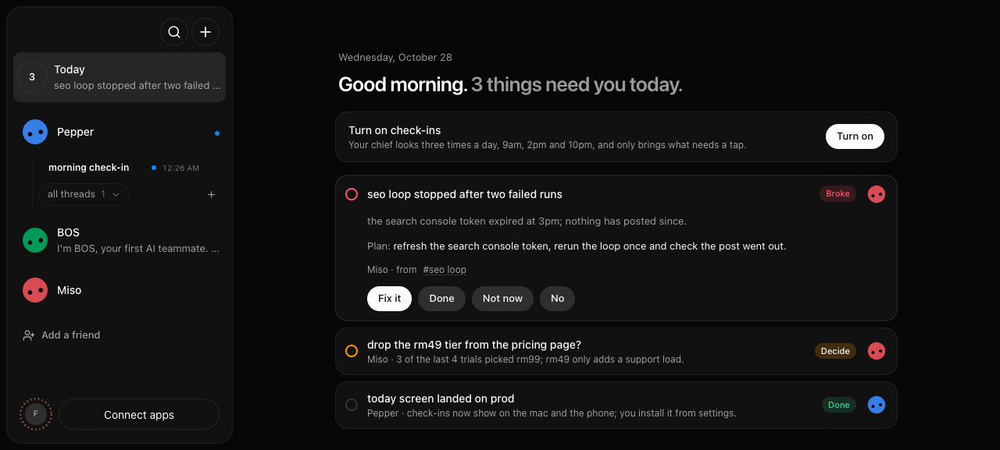
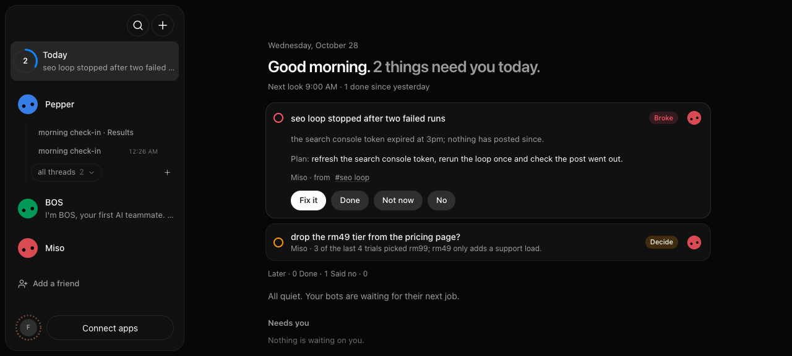
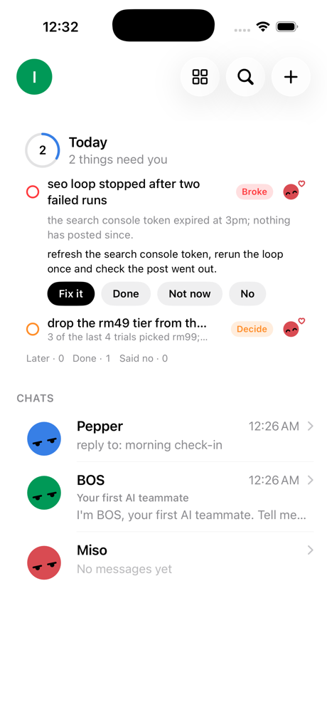
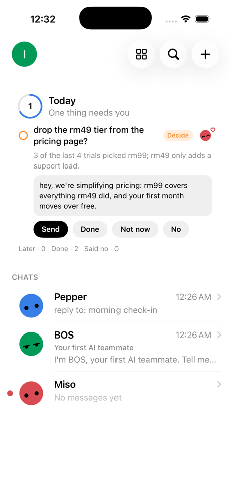

# Check-ins (3.0 today screen)

Checks the chief's check-in items end to end in a disposable fake-engine
fixture: `propose_item` through the real agents proxy, dedupe, the desktop
today screen and sidebar ring, set-up, the taps, and the iPhone today card.
It never touches the person's app.

## Run it

```sh
GATE=/tmp/ckn-gate-$RANDOM
FAKE_CLAUDE_SLOW_FINISH_GATE=$GATE node --experimental-strip-types scripts/control-omb.ts ui launch --mode slow > ui.json &
node --experimental-strip-types scripts/testing/checkins-seed.ts "$(jq -r .ui ui.json)" $GATE
```

scripts/testing/checkins-seed.ts turns on 3.0, makes the seeded bot chief,
adds a teammate, holds a chief turn open and calls `propose_item` three times
(decide with a draft and broke, both on the teammate's threads, and did on a
commit), then the decide item again (it must say "unchanged") and `list_items`.
It prints the `/api/checkins` snapshot.

Then drive the preview with `pnpm control:omb ui` verbs: set `bos-v3` in
localStorage, take a screenshot, tap "Turn on" (three cron routines at 9, 14 and
22 in the person's zone appear in `/api/routines`), expand the did item and tap
"Got it" (the count drops, the ring fills, "1 done since yesterday").

For the iPhone, mint an owner token with `/api/auth/pairing` and `/api/pair`,
build the Debug app for the "bos" simulator and launch it with
`-checkins-fixture-url <url> -checkins-fixture-token <token>` (debug builds only).
Approving the broke item through `/api/checkins/ID/approve` must start a fresh
thread on the teammate (the bot behind the source), not the chief, and the
phone card must refresh on its own.

Unit coverage: server/checkins.test.ts.

## Result (2026-10-28)





