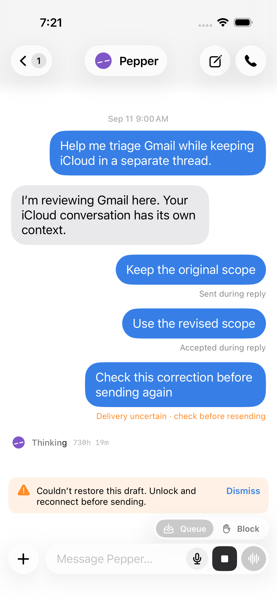
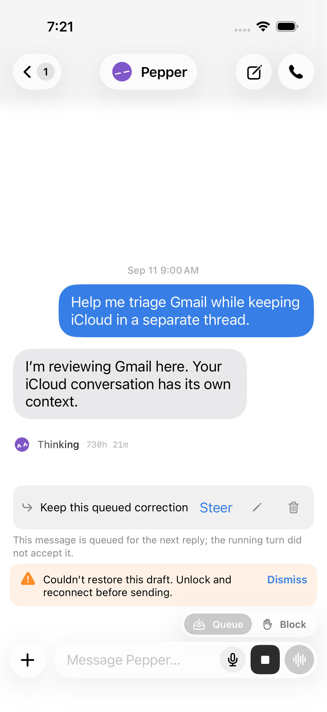

# steering delivery evidence

An explicit queue-steer request can succeed at HTTP level while its input
is refused or its delivery is uncertain. Direct chats now persist the same
message-level evidence as rooms, so reloading the transcript does not turn an
uncertain correction into an ordinary sent message. iOS decodes and caches
that evidence, folds an authoritative scoped receipt when SSE is late, and
explains a refusal while retaining the queued correction.

Claude and Codex have different confirmation boundaries:

- Claude stream-json confirms a successful stdin write: `transport_written`.
- Codex `turn/steer` confirms an RPC response with the expected running turn
  id: `provider_accepted`.
- A timeout or lost response can mean `outcome_unknown`. Such a correction
  is recorded once and must not be replayed into a new turn automatically.

Neither positive boundary proves model consumption. Direct-chat receipts
include `consumption: "unconfirmed"`, matching the existing room contract.
No adapter's steering or interrupt behavior changes in this update.

## isolated server checks

```sh
pnpm exec vitest run server/steer-e2e.test.ts server/steer-refusal-stop.e2e.test.ts
pnpm typecheck
```

These fixtures start real servers and fake provider processes in temporary
homes. They check Claude transport evidence, Codex acknowledgement evidence,
uncertain delivery retained on transcript reads, one copy of a correction,
refusal retaining the queue, and Stop during an in-flight steer without
replay. They do not contact personal accounts or run paid model turns.

## native client checks

```sh
cd ios
swift test
```

`SteeringDeliveryTests` covers cache round trips, legacy/future wire values,
distinct display states, delayed-SSE receipt folding, duplicate receipt
deduplication, refusal retaining the queue, and foreign-thread refusal.
`QueuedSendClientTests` verifies real request construction and receipt
decoding for direct chats and a pinned room member.

Generate the project and run on a newly created disposable simulator whose id
is supplied explicitly:

```sh
xcodegen generate
xcodebuild -project BosBot.xcodeproj -scheme BosBot \
  -configuration Debug \
  -destination 'platform=iOS Simulator,id=SIMULATOR_ID' \
  -derivedDataPath /tmp/bos-steering-build \
  -resultBundlePath /tmp/bos-steering-ui.xcresult \
  -parallel-testing-enabled NO \
  -only-testing:BosBotUITests/SteeringDeliveryUITests \
  CODE_SIGNING_ALLOWED=NO test
```

The label test uses `-store-preview -threads-preview -steering-preview` and
opens Pepper through the actual chat list. The refusal test uses
`-steering-preview-refusal`; its URL protocol intercepts every request and
returns an HTTP-200 refusal. It taps Steer, checks the inline explanation,
verifies no alert appeared, and checks the correction and Steer control remain. All preview code is
Debug-only, synthetic and unpaired. Retain the screenshots and `.xcresult`;
shut down/delete only the simulator created for this run.

### captured native evidence

These screenshots were captured from the two passing simulator tests on
2026-10-11 using synthetic, unpaired preview content:





The preview also shows an old synthetic thinking timestamp and a
draft-restoration warning. The tests verify the steering states and refusal
behavior; these captures do not establish acceptance of the entire screen.

## limits and baseline findings

These checks do not prove a paid model acted on a correction, physical-phone
frame pacing, upload/download performance, or a packaged production release.

On the 2026-10-11 prod baseline `121d0e994`, the broader five-file steering
run had 308 passes, four skips and four failures in `server/steer-queue.test.ts`.
Those four failures reported unavailable fake ACP provider instances; a
standalone check reproduced the failure. They were not introduced by this
update. A speculative fixture change did not resolve them and was removed.
The current change does not claim full provider-matrix coverage.

Strict lint also fails on an unchanged control-character regex in
`server/index.ts`; the same warning was reproduced from `121d0e994`.
The modified steering regression test lints cleanly. These baseline issues
remain visible for the production owner rather than being counted as passes.

After porting this change onto public `main` (`538d2c36c`), the isolated
steering/stop checks again passed (19 passed, 3 skipped) and typecheck passed.
The strict repository lint run reports 41 warnings on both unchanged public
`main` and this PR branch, with identical file/rule/message sets and no new
warnings. Consequently the local pre-push lint hook fails on the baseline too;
publishing this review branch does not assert that the full lint gate passes.
